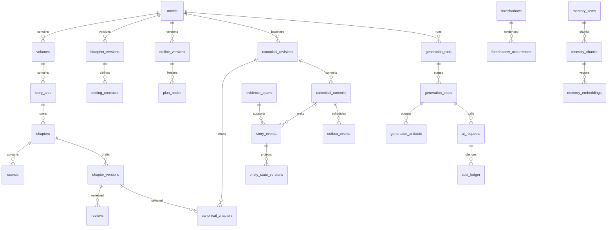

# NF-A04 领域与执行契约 v1

性质：拟实现的设计基线，不是现有代码功能。技术选择在本设计内固定，后续变更需ADR及兼容评估；外部供应商、预算和创作决定见DECISIONS，未代替用户批准。

## 1. 设计决策

| ADR | 决策与原因 |
| --- | --- |
| 001 | 业务主键统一bigint；HTTP/JSON把ID编码成十进制字符串，避免浏览器整数精度损失。现有users沿用bigint。数据集的字符串夹具ID只用于离线标注，不直接作数据库PK。 |
| 002 | 所有小说内对象带novel_id。父表提供UNIQUE(novel_id,id)，子表用复合FK约束归属；全局模型/模板表不伪造novel_id。普通外键默认RESTRICT。 |
| 003 | 稳定节点与不可变版本分离；计划不是事实，正文候选不是正式稿。正式章映射存canonical_chapters，不能仅用chapters.current_version解释多个基线。 |
| 004 | 正式事实由事件日志重放；快照和索引是可重建派生物。隐秘真相、信念和客观事实是不同类型，不以置信度升格事实。 |
| 005 | outbox与核心状态同事务；所有模型/嵌入/摘要调用在事务外。Redis至少一次投递，数据库唯一约束和fencing确保只一次有效变更。 |
| 006 | 金额numeric(24,10)，Token bigint>=0；JSON金额为十进制字符串。价格和币种版本化，未知实际费用为null+unknown，不填0。 |
| 007 | 数据库审计时间timestamptz，输出ISO8601含时区；故事时间独立结构，未知不补造时间。 |
| 008 | 中文分词按CR001为后期最低优先级，预留pg_jieba/zhparser但不阻塞当前交付；首期精确向量检索，HNSW经规模评测后启用。嵌入模型/维度未选定，不创建假定固定维度的索引。 |
| 009 | PRD队列planning/generation/review/memory/export/maintenance保留；P0同书正文生产并发1；跨书上限取供应商与预算共同允许值。 |
| 010 | API v1采用同源会话+CSRF，先不实现外部令牌；Filament调用同一应用服务。响应JSON不得包含密钥或完整内部异常。 |

## 2. 关系图与聚合边界

完整实体及约束以data_dictionary.csv为准；ER图是核心路径，不省略字典中的实体。规划聚合可变草稿，批准后只追加新版本；正文聚合只生成候选；正式聚合只能由提交服务写；派生检索聚合不能反向决定事实。

## 3. 版本、哈希与证据

- `row_version`为可变对象的乐观并发号，从1开始；内容对象的`version`是同稳定对象内递增序号。不能将这两者与小说`state_version`混用。
- 正文保存版本时统一CRLF/CR为LF，拒绝无效UTF-8；之后不trim、不做NFC、不自动重排标点，保留原始输入另存产物。body_hash=SHA-256(实际存储正文UTF-8字节)，算法标识`body-lf-utf8-sha256-v1`。
- JSON快照采用`json-canonical-v1`：键按Unicode码点排序、数组顺序不变、UTF-8无BOM、无无意义空格；字符串转义规则固定；禁止浮点、NaN和重复键，十进制量用字符串。实现前需建立跨PHP/浏览器黄金样例；不能依赖PG JSONB返回键顺序。
- evidence span指定source_version_id、source_hash、offset_unit=unicode_codepoint、start_offset/end_offset（左闭右开）、quote。必须满足0≤start<end≤原文码点长度且切片完全等于quote；前端UTF-16索引先转换。`甲😀乙`中😀为[1,2)，不是UTF-8字节1..5或UTF-16长度2。
- 来源正文任何变化均新版本；旧review、event extraction和span对新版本无效，不能直接重新绑定。可生成新证据并重新验证，不删旧失败。
- 字数设计为`visible-codepoint-v1`：正文为纯文本，排除标题、输出格式控制字段、Unicode空白和控制/格式字符；其余码点计1。合字/emoji组合可能多码点，需以边界黄金样例和作者测试前确认的计数政策冻结，不把字符数当模型Token数。

## 4. 状态机与守卫

| 对象 | 允许的主要迁移 | 守卫与副作用 |
| --- | --- | --- |
| 蓝图/计划 | draft→validating→needs_changes或approved/frozen；失败后复制新草稿；旧版superseded | 覆盖完整、歧义已决定；批准不自动改变已提交事实 |
| novel | draft→planning→ready→generating↔paused→completed；非活动书可archived | ready须具批准计划与配置；completed须终局门禁；归档禁止新生成 |
| run | queued→running→waiting_dependency/deferred/paused/needs_attention→running→succeeded；或failed/canceled | succeeded按声明目标逐项验证，不以最后Job返回为准；failed恢复新attempt，canceled保留证据且不续跑 |
| step attempt | queued→leased→running→succeeded/failed/deferred/quarantined | 租约和fencing匹配；输入过期产生新attempt，旧产物不可覆盖 |
| chapter显示态 | planned/drafting/reviewing/revision_required/ready_to_commit/committed/accepted/stale | 此为组合投影；accepted是特定正文版本的人工作品认可，不能覆盖正式提交状态 |
| review | pending→running→pass或block；正文改变后stale | 绑定body/context/policy/validation hash；人工只能接受非阻塞文学问题 |
| revision task | draft→running→awaiting_selection→reviewing→accepted/rejected | accepted仅采纳候选正文，仍须正式提交 |
| canonical revision | candidate→validating→validated→active→superseded；或rejected | 仅完整重验链可成为active；原active一直可读 |
| foreshadow | planned→planted→reinforced/due→paid_off；经作者决定可abandoned | planted/paid_off只有commit证据驱动；overdue为独立标记；不得直接勾选回收 |
| memory/index | pending→active/stale/failed；index building→catching_up→validated→active→retired | 来源/基线有效；影子追赶完成才切换；错误保留可回滚 |
| prompt/route/style | draft→tested→published→retired | 已发布版本不可编辑；只改新运行默认指针 |
| reservation | reserved→settled/released/uncertain | 请求发出且结果未知不得释放；同账单分类幂等 |
| acceptance | not_run→running→system_pass→human_pending→accepted或rejected | 需要人工的用例不能自动accepted；新契约新批次 |

非法迁移返回409+INVALID_TRANSITION并记录原因，不靠隐藏按钮实现守卫。

## 5. Canonical Commit协议

输入：novel_id、chapter_id、chapter_version_id、review_id、expected_revision_id、expected_state_version、plan_node_version_id、event_artifact_id、validation_artifact_id、reason；Idempotency-Key必填。API示例另见接口契约。

1. 身份鉴权、小说归属和基本格式检查。对同书幂等键查请求哈希；同载荷且已提交返回原结果，不先用最新游标拒绝合法重试；不同载荷409 IDEMPOTENCY_CONFLICT。
2. 事务内锁novels，再锁目标revision和chapter（固定顺序）；重新查幂等记录，校验active_revision和全局state_version、前一章正式映射及当前章未被其他提交占用。
3. 重验正文完整性、批准计划/覆盖、评审PASS及所有哈希、事件/补丁结构、证据与实体、POV/时间/世界规则、必要伏笔；人工PASS不跳过这些门禁。
4. 同事务写canonical_commit、canonical_chapters映射、story_events、entity_state_versions/知识/关系投影、foreshadow_occurrences与状态、revision章游标、novel.state_version+1、audit与outbox。数据库unique是最终竞争保护。
5. 提交事务后返回；outbox异步摘要/索引。任何一步异常全部回滚；对象存储产物须已验证存在且不可变，事务只存引用。孤儿候选产物由保留策略清理，不能先公开成正式稿。

全局`novels.state_version`为活动状态变更令牌，不等同章号；提交与活动基线切换都递增。候选基线回放使用自己的local_state_version/cursor，不推进全局游标。基线切换锁novel并CAS expected_revision/state_version；验证完成前不能把候选指针暴露给普通读取。

P0历史修订采用从改动章起全下游复核。未变化的前缀可显式继承原版本映射；每个有效读取解析到唯一chapter_version。旧基线映射和证据永久可读；所谓标点修订也新版本并重新验证事实等价。正式事实更正使用替代/撤销事件，不删除事件历史。

## 6. DAG与重试

Intake→Blueprint→Outline→ChapterPlan→ScenePlan→Context→DraftScene→AssembleChapter→ExtractEvents→ValidateState→Review↔Revise→CanonicalCommit→MemoryIndex→ExportReady。编排阶段契约固定输入IDs/hashes、schema_version、输出artifact类型、预算类别与依赖；各实际实现任务负责补其内容Schema，不能用无约束JSON“通用阶段”上线。

阶段冻结fingerprint包含计划、前序正式基线/状态、正文、Prompt、路由、能力、价格、策略与上下文。identity完全相同且已验证产物才可复用。预算额度可批准追加，但策略变更和路由变更必须新attempt并记录影响。

Worker先认领租约递增fencing_token；运行前后均核验token、取消和依赖版本。网络调用不持有数据库行锁。网络超时/429/部分5xx最多3次技术尝试（含首次），退避+抖动；未知是否计费先uncertain，不无限重发。文学自动修订最多3轮，与技术尝试独立。结构修复最多一次且不能补造剧情。暂停后结果留证不自动提交；取消后新调度停止，迟到结果隔离。outbox发布后回写失败导致重投时由consumer receipt唯一键去重。

## 7. 费用、检索与上下文协议

费用预留按请求、章、运行、书、日涉及预算桶固定顺序加锁；当前已结算+有效预留+新最坏成本≤每桶限额才准发请求。金额类别和推理Token计量取实际price/capability版本；缺价格或容量即blocked，不猜测。Usage不足为unknown/uncertain，补账需凭证；重复供应商请求号和分类流水不能重复记账。外部账单变化可能超过估计，系统停止新请求但不伪造历史费用。

检索必须首先约束novel、active revision、来源有效、截止叙述章和角色可见性；ANN候选不足不得放宽过滤。当前精确/别名/向量/trgm分别召回，后期可增加词法通道，再去重融合。关键事实、到期伏笔、终局约束确定性注入，不依赖排名。作者隐藏计划单独区域，不作为POV可知事实。

Context Manifest逐项保存来源ID/版本/hash、类别、token估算方法、排名、纳入/裁剪理由和顺序；final_prompt_hash绑定实际发送文本。容量=输入+最大输出+单独适用推理预留+安全余量，不能重复计量；硬约束不能被裁剪。索引延迟补查最新事件与最近正文，不足则等待。摘要压缩漏不可逆事实不激活新版。

## 8. 索引与迁移顺序

| 批次 | 实体/操作 | 实施任务 |
| --- | --- | --- |
| 1 | novels、requirements、稳定层级、初始实体与版本；空活动基线FK随后添加 | B01–B03 |
| 2 | blueprint/ending/outline/plan/thread及覆盖、风格引用 | B04/B05；与C04全局配置通过分批FK衔接 |
| 3 | runs/steps/artifacts/outbox/audit、provider/route/prompt/style、price/budget/request/ledger | C01–C07 |
| 4 | evidence、events/state/knowledge/foreshadow、memory/search/embedding代次 | D01–D06；尚不开放正式写入口 |
| 5 | scene/chapter versions、review/revision、canonical revisions/commits/mapping及novel活动FK | E02–E07；与批4相互引用FK在所依赖表存在后补齐 |
| 6 | export/acceptance、完整索引代次与baseline变更、backup/retention | E08/F02/G01/G02/H04 |

B-tree覆盖书内顺序、事件章位、状态版本、角色获得知识章、伏笔到期、阶段租约、outbox待投递；GIN当前覆盖实体别名trgm；中文tsvector GIN后期启用；JSONB只按实际查询建索引。向量profile固定后独立表/分区绑定维度与距离操作类，不同维度不共一个索引。

先建可空引用/被引用表，完成回填后添加外键与NOT NULL；正式指针环不通过关闭外键解决。发布采用先兼容读写再切换生产者，最后收缩；不可逆数据变化回滚依赖保留版本/备份，不承诺任意down均无损。中文扩展运维与业务迁移分离，应用账号无安装权限。

## 9. 评审边界

本轮完成PRD逻辑实体覆盖、接口/状态/数据字典交叉一致性、自检与样例引用检查；未执行Schema迁移、并发提交、提供商结构化输出或业务接口测试。模型/嵌入参数保留待决；设计不是人工文学验收或生产兼容性证明。

## NF-B02 实施补充（2026-10-23）

本节细化结构快照，不替代上文批准规划状态机。工作节点skeleton/detailed为成熟度；不可变结构快照在同一事务内building→sealed，generation_eligible=false。sealed不等于approved/frozen。B04/B05审批、覆盖与预算门禁仍待实施，不能将历史快照原地升级为生成批准。

稳定卷以novel_id直接连接根；其他层使用parent_id与novel_id复合FK。plan_nodes以四个具体类型FK实现stable_node_id逻辑角色，恰有一个且与node_type匹配；父节点必须同书、同版本、正确层级并匹配稳定父级。来源source_version_id当前指premise_versions。blueprint_versions尚未建立，蓝图FK及审批记录由B04/B05补充；旧版本保持不可变。

Thread仅实现B02同书身份、标题/目标和arc_thread关系，主支线审批和终局仍属于B04。详细字段、约束、接口、页面及实际验收见[记录](../phase-b/NF-B02_ACCEPTANCE.md)。

## NF-B03 实施补充（2026-10-23）

实体稳定ID保留current_version_id与approved_version_id；设定从首次保存就不可变，批准另写不可变entity_approvals，不改旧definition/hash。候选/批准/停用是资格与界面投影，sealed仅是存储封存，不是批准。初始关系绑定同书具体设定版本，独立于未来正式relationships。

别名合并创建目标新候选并以alias_origin_version_id保存来源，不删除实体或重绑旧证据；别名唯一性作用于具体设定版本。同名跨实体只作为歧义候选。引用检查要求具体设定版本已批准且实体未停用，历史内容仍可读取；正式正文证据与状态变更仍由D/E模块负责。

核心实体人工批准。非关键路人引入默认关闭，作者明确批准不可变策略后才可执行确定性接纳命令。minor-v1及完整限制快照随策略保存：仅character/minor/extra、无能力/初始关系/规则/主线影响、章窗口和每策略版本累计数量限制。新调用必须使用最新启用策略；修改规则语义须新schema/策略版本，旧批准记录保留。基于作者字段的分类不替代正文语义校验。

字段、数据库约束与验收证据见[NF-B03记录](../phase-b/NF-B03_ACCEPTANCE.md)。世界规则当前保留原文与范围，不宣称已完成自动规则推理；AC12/AC13完整验收未执行。

## NF-B04 实施补充（2026-10-23）

blueprint_versions在事务内building→sealed，保存后不可变；审批资格通过不可变blueprint_validations/blueprint_approvals表达。display_status为draft/needs_changes/approved/superseded历史投影，sealed不等于批准。检查记录固定blueprint-check-v1、内容hash、依赖hash、操作者及原因；批准重跑检查并验证validation_id/report_hash，同时要求确认变更影响。批准不设小说ready、不改正式state_version，generation_eligible=false。

每个蓝图版本同事务生成独立ending_contracts及主支线、实体引用、蓝图专用要求覆盖；要求引用通过新增(novel_id,id)唯一索引建立同书FK。blueprint_requirement_coverages是蓝图字段原文证据，不替代B05的requirement_coverages→plan_nodes。outline_versions由B02封存后被B04引用，B05添加反向蓝图引用时不得改旧结构版本。

核心人物结局、反转、最终关系及答案变化追加新契约；影响范围保守包含新旧结构卷章并集和规划伏笔承诺，未接入的正式正文/账本影响为null。作者六项内容检查与精确引用不等于自动语义或文学验收。详见[NF-B04记录](../phase-b/NF-B04_ACCEPTANCE.md)。

## NF-B05 实施补充（2026-10-23）

新 rolling_plans 以同书真实 FK 绑定新 outline_versions 与批准 blueprint_versions；不原地改旧结构版本。requirement_coverages 引用同一计划的 plan_nodes 与当前 requirement_versions，采用 Unicode 码点左闭右开偏移和字段 SHA-256，数据库校验引文。plan_validations / plan_freezes 是只追加审计，冻结重验完整报告hash。

首窗前十章，后续5–10章（尾窗可短）；全书骨架与详细窗口分离，场景三项字数预算逐项求和等于章节。B05允许章场景细化而不复用B04完整树hash；仍验证卷弧/Thread/输入要求/实体批准/终局。冻结窗口不能直接修改，正式state_version>0保守导向尚未接入的历史流程。未冻结候选跟踪完整树；冻结版本跟踪窗口与覆盖节点，后续正常细化不污染前窗。规划ready/frozen不授予generation_eligible。详见../phase-b/NF-B05_ACCEPTANCE.md。

## NF-B06 只读工作台投影（2026-10-23）

创作上下文由每条URL中的小说ID确定，服务层验证管理员及所有权，不使用跨标签页的全局当前书。工作台读取novels、当前要求、蓝图批准与滚动计划，使用B05现有报告，不另造一套冻结规则。有效冻结数量按当前通过的冻结窗口章序去重，过期历史冻结仍保留但不算当前资格。planning_frozen不代表generation_eligible；所有未接入正式指标明确null。共享行锁确保摘要与既有写服务的小说行锁互斥，不新增业务表或写命令。

### NF-C01 已实施边界（2026-10-23）

持久编排使用 generation_runs/steps/artifacts 与 generation_dependencies。DAG 冻结在 run JSON；实际消费的产物边以同运行复合 FK 保存。创建响应复用 novel_commands 的 generation.test.start 命令域；尝试号及活动节点有数据库唯一性约束，产物/历史尝试不可变。test-dag-v1 仅冻结真实规划 ID/hash、state_version、测试图和测试执行版本；不得冒充生产全套 fingerprint。

当前 StageExecutor 只由 testing 环境的 test.echo 支架驱动，输出 schema=test.echo-v1。status 的 canceled 为 A04 规范拼写，任务清单 cancelled 同义；增加显式 blocked，保持与 deferred/failed 的区分。暂停状态仅保留，leased/fencing/outbox 待 C02；不宣称在途 Worker 自动恢复。生产路由、Prompt、预算、上下文等身份须后续模块真实实现后扩展。详见 ../phase-c/NF-C01_ACCEPTANCE.md。

### NF-C02 已实施边界（2026-10-23）

新增持久 outbox 意图、消费回执、数据库租约与每书队列运行串行槽。startQueued 的运行与意图同事务，发布不依赖 Redis 持久性；无回执通知可再次发送。C01 claim/complete 现均检查 owner/fencing_token/lease_until，旧令牌不能续期或提交。认领原子进入 running，租约字段表达已认领，不额外保存 leased 短暂状态。重新认领同一测试尝试递增 fencing_token，显式 retryOf 才递增 attempt_no；乱序通知不得错认尝试。

timeout=60秒、租约=90秒、Redis retry_after 默认120秒、重投60秒、每分钟扫描。paused/canceled 在结果落盘前复查。回执与产物/状态共事务；跨 Worker 恰好一次有效结果不等于消息恰好一次。仍仅测试阶段可执行；真实供应商未知请求处理须后续模块完成，不能据此宣称无重复外部费用。详见 ../phase-c/NF-C02_ACCEPTANCE.md 与 NF-C02_OPERATIONS.md。

### NF-C03 已实施边界（2026-10-24）

供应商安全配置与密钥分版本保存，模型能力声明不可变但verification_status固定unverified；声明不等于实测。ai_requests绑定同书run/step及供应商/模型版本，step+logical_key唯一，冻结C02令牌；原始请求/响应证据仅以加密脱敏形式保存，完整错误原文不入日志。unknown保留在途占用，不自动重发，缺Usage为null。测试结果标为fake/not_billable_fake，不虚构价格和真实能力。

当前网关与通用JSON HTTP支架仅测试环境可用，真实供应商/探测在A02部署条件、C05预算门禁和外部授权前硬拒绝。端点精确白名单、公网DNS全量核验、NAT64/内网拒绝、curl固定IP、无代理/重定向均有离线反例；并未实测真实公网传输。所有新增表/字段带中文数据库备注。详见 ../phase-c/NF-C03_ACCEPTANCE.md。
