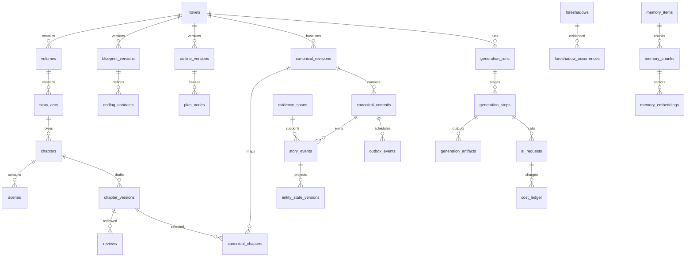

# NF-A04 领域与执行契约 v1

性质：拟实现的设计基线，不是现有代码功能。技术选择在本设计内固定，后续变更需ADR及兼容评估；外部供应商、预算和创作决定见DECISIONS，未代替用户批准。

## 1. 设计决策

| ADR | 决策与原因 |
| --- | --- |
| 001 | 业务主键统一bigint；HTTP/JSON把ID编码成十进制字符串，避免浏览器整数精度损失。现有users沿用bigint。数据集的字符串夹具ID只用于离线标注，不直接作数据库PK。 |
| 002 | 所有小说内对象带novel_id。父表提供UNIQUE(novel_id,id)，子表用复合FK约束归属；全局模型/模板表不伪造novel_id。普通外键默认RESTRICT。 |
| 003 | 稳定节点与不可变版本分离；计划不是事实，正文候选不是正式稿。正式章映射存canonical_chapters，不能仅用chapters.current_version解释多个基线。 |
| 004 | 正式事实由事件日志重放；快照和索引是可重建派生物。隐秘真相、信念和客观事实是不同类型，不以置信度升格事实。 |
| 005 | outbox与核心状态同事务；所有模型/嵌入/摘要调用在事务外。Redis至少一次投递，数据库唯一约束和fencing确保只一次有效变更。 |
| 006 | 金额numeric(24,10)，Token bigint>=0；JSON金额为十进制字符串。价格和币种版本化，未知实际费用为null+unknown，不填0。 |
| 007 | 数据库审计时间timestamptz，输出ISO8601含时区；故事时间独立结构，未知不补造时间。 |
| 008 | 中文分词按CR001为后期最低优先级，预留pg_jieba/zhparser但不阻塞当前交付；首期精确向量检索，HNSW经规模评测后启用。嵌入模型/维度未选定，不创建假定固定维度的索引。 |
| 009 | PRD队列planning/generation/review/memory/export/maintenance保留；P0同书正文生产并发1；跨书上限取供应商与预算共同允许值。 |
| 010 | API v1采用同源会话+CSRF，先不实现外部令牌；Filament调用同一应用服务。响应JSON不得包含密钥或完整内部异常。 |

## 2. 关系图与聚合边界

完整实体及约束以data_dictionary.csv为准；ER图是核心路径，不省略字典中的实体。规划聚合可变草稿，批准后只追加新版本；正文聚合只生成候选；正式聚合只能由提交服务写；派生检索聚合不能反向决定事实。

## 3. 版本、哈希与证据

- `row_version`为可变对象的乐观并发号，从1开始；内容对象的`version`是同稳定对象内递增序号。不能将这两者与小说`state_version`混用。
- 正文保存版本时统一CRLF/CR为LF，拒绝无效UTF-8；之后不trim、不做NFC、不自动重排标点，保留原始输入另存产物。body_hash=SHA-256(实际存储正文UTF-8字节)，算法标识`body-lf-utf8-sha256-v1`。
- JSON快照采用`json-canonical-v1`：键按Unicode码点排序、数组顺序不变、UTF-8无BOM、无无意义空格；字符串转义规则固定；禁止浮点、NaN和重复键，十进制量用字符串。实现前需建立跨PHP/浏览器黄金样例；不能依赖PG JSONB返回键顺序。
- evidence span指定source_version_id、source_hash、offset_unit=unicode_codepoint、start_offset/end_offset（左闭右开）、quote。必须满足0≤start<end≤原文码点长度且切片完全等于quote；前端UTF-16索引先转换。`甲😀乙`中😀为[1,2)，不是UTF-8字节1..5或UTF-16长度2。
- 来源正文任何变化均新版本；旧review、event extraction和span对新版本无效，不能直接重新绑定。可生成新证据并重新验证，不删旧失败。
- 字数设计为`visible-codepoint-v1`：正文为纯文本，排除标题、输出格式控制字段、Unicode空白和控制/格式字符；其余码点计1。合字/emoji组合可能多码点，需以边界黄金样例和作者测试前确认的计数政策冻结，不把字符数当模型Token数。

## 4. 状态机与守卫

| 对象 | 允许的主要迁移 | 守卫与副作用 |
| --- | --- | --- |
| 蓝图/计划 | draft→validating→needs_changes或approved/frozen；失败后复制新草稿；旧版superseded | 覆盖完整、歧义已决定；批准不自动改变已提交事实 |
| novel | draft→planning→ready→generating↔paused→completed；非活动书可archived | ready须具批准计划与配置；completed须终局门禁；归档禁止新生成 |
| run | queued→running→waiting_dependency/deferred/paused/needs_attention→running→succeeded；或failed/canceled | succeeded按声明目标逐项验证，不以最后Job返回为准；failed恢复新attempt，canceled保留证据且不续跑 |
| step attempt | queued→leased→running→succeeded/failed/deferred/quarantined | 租约和fencing匹配；输入过期产生新attempt，旧产物不可覆盖 |
| chapter显示态 | planned/drafting/reviewing/revision_required/ready_to_commit/committed/accepted/stale | 此为组合投影；accepted是特定正文版本的人工作品认可，不能覆盖正式提交状态 |
| review | pending→running→pass或block；正文改变后stale | 绑定body/context/policy/validation hash；人工只能接受非阻塞文学问题 |
| revision task | draft→running→awaiting_selection→reviewing→accepted/rejected | accepted仅采纳候选正文，仍须正式提交 |
| canonical revision | candidate→validating→validated→active→superseded；或rejected | 仅完整重验链可成为active；原active一直可读 |
| foreshadow | planned→planted→reinforced/due→paid_off；经作者决定可abandoned | planted/paid_off只有commit证据驱动；overdue为独立标记；不得直接勾选回收 |
| memory/index | pending→active/stale/failed；index building→catching_up→validated→active→retired | 来源/基线有效；影子追赶完成才切换；错误保留可回滚 |
| prompt/route/style | draft→tested→published→retired | 已发布版本不可编辑；只改新运行默认指针 |
| reservation | reserved→settled/released/uncertain | 请求发出且结果未知不得释放；同账单分类幂等 |
| acceptance | not_run→running→system_pass→human_pending→accepted或rejected | 需要人工的用例不能自动accepted；新契约新批次 |

非法迁移返回409+INVALID_TRANSITION并记录原因，不靠隐藏按钮实现守卫。

## 5. Canonical Commit协议

输入：novel_id、chapter_id、chapter_version_id、review_id、expected_revision_id、expected_state_version、plan_node_version_id、event_artifact_id、validation_artifact_id、reason；Idempotency-Key必填。API示例另见接口契约。

1. 身份鉴权、小说归属和基本格式检查。对同书幂等键查请求哈希；同载荷且已提交返回原结果，不先用最新游标拒绝合法重试；不同载荷409 IDEMPOTENCY_CONFLICT。
2. 事务内锁novels，再锁目标revision和chapter（固定顺序）；重新查幂等记录，校验active_revision和全局state_version、前一章正式映射及当前章未被其他提交占用。
3. 重验正文完整性、批准计划/覆盖、评审PASS及所有哈希、事件/补丁结构、证据与实体、POV/时间/世界规则、必要伏笔；人工PASS不跳过这些门禁。
4. 同事务写canonical_commit、canonical_chapters映射、story_events、entity_state_versions/知识/关系投影、foreshadow_occurrences与状态、revision章游标、novel.state_version+1、audit与outbox。数据库unique是最终竞争保护。
5. 提交事务后返回；outbox异步摘要/索引。任何一步异常全部回滚；对象存储产物须已验证存在且不可变，事务只存引用。孤儿候选产物由保留策略清理，不能先公开成正式稿。

全局`novels.state_version`为活动状态变更令牌，不等同章号；提交与活动基线切换都递增。候选基线回放使用自己的local_state_version/cursor，不推进全局游标。基线切换锁novel并CAS expected_revision/state_version；验证完成前不能把候选指针暴露给普通读取。

P0历史修订采用从改动章起全下游复核。未变化的前缀可显式继承原版本映射；每个有效读取解析到唯一chapter_version。旧基线映射和证据永久可读；所谓标点修订也新版本并重新验证事实等价。正式事实更正使用替代/撤销事件，不删除事件历史。

## 6. DAG与重试

Intake→Blueprint→Outline→ChapterPlan→ScenePlan→Context→DraftScene→AssembleChapter→ExtractEvents→ValidateState→Review↔Revise→CanonicalCommit→MemoryIndex→ExportReady。编排阶段契约固定输入IDs/hashes、schema_version、输出artifact类型、预算类别与依赖；各实际实现任务负责补其内容Schema，不能用无约束JSON“通用阶段”上线。

阶段冻结fingerprint包含计划、前序正式基线/状态、正文、Prompt、路由、能力、价格、策略与上下文。identity完全相同且已验证产物才可复用。预算额度可批准追加，但策略变更和路由变更必须新attempt并记录影响。

Worker先认领租约递增fencing_token；运行前后均核验token、取消和依赖版本。网络调用不持有数据库行锁。网络超时/429/部分5xx最多3次技术尝试（含首次），退避+抖动；未知是否计费先uncertain，不无限重发。文学自动修订最多3轮，与技术尝试独立。结构修复最多一次且不能补造剧情。暂停后结果留证不自动提交；取消后新调度停止，迟到结果隔离。outbox发布后回写失败导致重投时由consumer receipt唯一键去重。

## 7. 费用、检索与上下文协议

费用预留按请求、章、运行、书、日涉及预算桶固定顺序加锁；当前已结算+有效预留+新最坏成本≤每桶限额才准发请求。金额类别和推理Token计量取实际price/capability版本；缺价格或容量即blocked，不猜测。Usage不足为unknown/uncertain，补账需凭证；重复供应商请求号和分类流水不能重复记账。外部账单变化可能超过估计，系统停止新请求但不伪造历史费用。

检索必须首先约束novel、active revision、来源有效、截止叙述章和角色可见性；ANN候选不足不得放宽过滤。当前精确/别名/向量/trgm分别召回，后期可增加词法通道，再去重融合。关键事实、到期伏笔、终局约束确定性注入，不依赖排名。作者隐藏计划单独区域，不作为POV可知事实。

Context Manifest逐项保存来源ID/版本/hash、类别、token估算方法、排名、纳入/裁剪理由和顺序；final_prompt_hash绑定实际发送文本。容量=输入+最大输出+单独适用推理预留+安全余量，不能重复计量；硬约束不能被裁剪。索引延迟补查最新事件与最近正文，不足则等待。摘要压缩漏不可逆事实不激活新版。

## 8. 索引与迁移顺序

| 批次 | 实体/操作 | 实施任务 |
| --- | --- | --- |
| 1 | novels、requirements、稳定层级、初始实体与版本；空活动基线FK随后添加 | B01–B03 |
| 2 | blueprint/ending/outline/plan/thread及覆盖、风格引用 | B04/B05；与C04全局配置通过分批FK衔接 |
| 3 | runs/steps/artifacts/outbox/audit、provider/route/prompt/style、price/budget/request/ledger | C01–C07 |
| 4 | evidence、events/state/knowledge/foreshadow、memory/search/embedding代次 | D01–D06；尚不开放正式写入口 |
| 5 | scene/chapter versions、review/revision、canonical revisions/commits/mapping及novel活动FK | E02–E07；与批4相互引用FK在所依赖表存在后补齐 |
| 6 | export/acceptance、完整索引代次与baseline变更、backup/retention | E08/F02/G01/G02/H04 |

B-tree覆盖书内顺序、事件章位、状态版本、角色获得知识章、伏笔到期、阶段租约、outbox待投递；GIN当前覆盖实体别名trgm；中文tsvector GIN后期启用；JSONB只按实际查询建索引。向量profile固定后独立表/分区绑定维度与距离操作类，不同维度不共一个索引。

先建可空引用/被引用表，完成回填后添加外键与NOT NULL；正式指针环不通过关闭外键解决。发布采用先兼容读写再切换生产者，最后收缩；不可逆数据变化回滚依赖保留版本/备份，不承诺任意down均无损。中文扩展运维与业务迁移分离，应用账号无安装权限。

## 9. 评审边界

本轮完成PRD逻辑实体覆盖、接口/状态/数据字典交叉一致性、自检与样例引用检查；未执行Schema迁移、并发提交、提供商结构化输出或业务接口测试。模型/嵌入参数保留待决；设计不是人工文学验收或生产兼容性证明。

## NF-B02 实施补充（2026-10-23）

本节细化结构快照，不替代上文批准规划状态机。工作节点skeleton/detailed为成熟度；不可变结构快照在同一事务内building→sealed，generation_eligible=false。sealed不等于approved/frozen。B04/B05审批、覆盖与预算门禁仍待实施，不能将历史快照原地升级为生成批准。

稳定卷以novel_id直接连接根；其他层使用parent_id与novel_id复合FK。plan_nodes以四个具体类型FK实现stable_node_id逻辑角色，恰有一个且与node_type匹配；父节点必须同书、同版本、正确层级并匹配稳定父级。来源source_version_id当前指premise_versions。blueprint_versions尚未建立，蓝图FK及审批记录由B04/B05补充；旧版本保持不可变。

Thread仅实现B02同书身份、标题/目标和arc_thread关系，主支线审批和终局仍属于B04。详细字段、约束、接口、页面及实际验收见[记录](../phase-b/NF-B02_ACCEPTANCE.md)。

## NF-B03 实施补充（2026-10-23）

实体稳定ID保留current_version_id与approved_version_id；设定从首次保存就不可变，批准另写不可变entity_approvals，不改旧definition/hash。候选/批准/停用是资格与界面投影，sealed仅是存储封存，不是批准。初始关系绑定同书具体设定版本，独立于未来正式relationships。

别名合并创建目标新候选并以alias_origin_version_id保存来源，不删除实体或重绑旧证据；别名唯一性作用于具体设定版本。同名跨实体只作为歧义候选。引用检查要求具体设定版本已批准且实体未停用，历史内容仍可读取；正式正文证据与状态变更仍由D/E模块负责。

核心实体人工批准。非关键路人引入默认关闭，作者明确批准不可变策略后才可执行确定性接纳命令。minor-v1及完整限制快照随策略保存：仅character/minor/extra、无能力/初始关系/规则/主线影响、章窗口和每策略版本累计数量限制。新调用必须使用最新启用策略；修改规则语义须新schema/策略版本，旧批准记录保留。基于作者字段的分类不替代正文语义校验。

字段、数据库约束与验收证据见[NF-B03记录](../phase-b/NF-B03_ACCEPTANCE.md)。世界规则当前保留原文与范围，不宣称已完成自动规则推理；AC12/AC13完整验收未执行。

## NF-B04 实施补充（2026-10-23）

blueprint_versions在事务内building→sealed，保存后不可变；审批资格通过不可变blueprint_validations/blueprint_approvals表达。display_status为draft/needs_changes/approved/superseded历史投影，sealed不等于批准。检查记录固定blueprint-check-v1、内容hash、依赖hash、操作者及原因；批准重跑检查并验证validation_id/report_hash，同时要求确认变更影响。批准不设小说ready、不改正式state_version，generation_eligible=false。

每个蓝图版本同事务生成独立ending_contracts及主支线、实体引用、蓝图专用要求覆盖；要求引用通过新增(novel_id,id)唯一索引建立同书FK。blueprint_requirement_coverages是蓝图字段原文证据，不替代B05的requirement_coverages→plan_nodes。outline_versions由B02封存后被B04引用，B05添加反向蓝图引用时不得改旧结构版本。

核心人物结局、反转、最终关系及答案变化追加新契约；影响范围保守包含新旧结构卷章并集和规划伏笔承诺，未接入的正式正文/账本影响为null。作者六项内容检查与精确引用不等于自动语义或文学验收。详见[NF-B04记录](../phase-b/NF-B04_ACCEPTANCE.md)。

## NF-B05 实施补充（2026-10-23）

新 rolling_plans 以同书真实 FK 绑定新 outline_versions 与批准 blueprint_versions；不原地改旧结构版本。requirement_coverages 引用同一计划的 plan_nodes 与当前 requirement_versions，采用 Unicode 码点左闭右开偏移和字段 SHA-256，数据库校验引文。plan_validations / plan_freezes 是只追加审计，冻结重验完整报告hash。

首窗前十章，后续5–10章（尾窗可短）；全书骨架与详细窗口分离，场景三项字数预算逐项求和等于章节。B05允许章场景细化而不复用B04完整树hash；仍验证卷弧/Thread/输入要求/实体批准/终局。冻结窗口不能直接修改，正式state_version>0保守导向尚未接入的历史流程。未冻结候选跟踪完整树；冻结版本跟踪窗口与覆盖节点，后续正常细化不污染前窗。规划ready/frozen不授予generation_eligible。详见../phase-b/NF-B05_ACCEPTANCE.md。

## NF-B06 只读工作台投影（2026-10-23）

创作上下文由每条URL中的小说ID确定，服务层验证管理员及所有权，不使用跨标签页的全局当前书。工作台读取novels、当前要求、蓝图批准与滚动计划，使用B05现有报告，不另造一套冻结规则。有效冻结数量按当前通过的冻结窗口章序去重，过期历史冻结仍保留但不算当前资格。planning_frozen不代表generation_eligible；所有未接入正式指标明确null。共享行锁确保摘要与既有写服务的小说行锁互斥，不新增业务表或写命令。

### NF-C01 已实施边界（2026-10-23）

持久编排使用 generation_runs/steps/artifacts 与 generation_dependencies。DAG 冻结在 run JSON；实际消费的产物边以同运行复合 FK 保存。创建响应复用 novel_commands 的 generation.test.start 命令域；尝试号及活动节点有数据库唯一性约束，产物/历史尝试不可变。test-dag-v1 仅冻结真实规划 ID/hash、state_version、测试图和测试执行版本；不得冒充生产全套 fingerprint。

当前 StageExecutor 只由 testing 环境的 test.echo 支架驱动，输出 schema=test.echo-v1。status 的 canceled 为 A04 规范拼写，任务清单 cancelled 同义；增加显式 blocked，保持与 deferred/failed 的区分。暂停状态仅保留，leased/fencing/outbox 待 C02；不宣称在途 Worker 自动恢复。生产路由、Prompt、预算、上下文等身份须后续模块真实实现后扩展。详见 ../phase-c/NF-C01_ACCEPTANCE.md。

### NF-C02 已实施边界（2026-10-23）

新增持久 outbox 意图、消费回执、数据库租约与每书队列运行串行槽。startQueued 的运行与意图同事务，发布不依赖 Redis 持久性；无回执通知可再次发送。C01 claim/complete 现均检查 owner/fencing_token/lease_until，旧令牌不能续期或提交。认领原子进入 running，租约字段表达已认领，不额外保存 leased 短暂状态。重新认领同一测试尝试递增 fencing_token，显式 retryOf 才递增 attempt_no；乱序通知不得错认尝试。

timeout=60秒、租约=90秒、Redis retry_after 默认120秒、重投60秒、每分钟扫描。paused/canceled 在结果落盘前复查。回执与产物/状态共事务；跨 Worker 恰好一次有效结果不等于消息恰好一次。仍仅测试阶段可执行；真实供应商未知请求处理须后续模块完成，不能据此宣称无重复外部费用。详见 ../phase-c/NF-C02_ACCEPTANCE.md 与 NF-C02_OPERATIONS.md。

### NF-C03 已实施边界（2026-10-24）

供应商安全配置与密钥分版本保存，模型能力声明不可变但verification_status固定unverified；声明不等于实测。ai_requests绑定同书run/step及供应商/模型版本，step+logical_key唯一，冻结C02令牌；原始请求/响应证据仅以加密脱敏形式保存，完整错误原文不入日志。unknown保留在途占用，不自动重发，缺Usage为null。测试结果标为fake/not_billable_fake，不虚构价格和真实能力。

当前网关与通用JSON HTTP支架仅测试环境可用，真实供应商/探测在A02部署条件、C05预算门禁和外部授权前硬拒绝。端点精确白名单、公网DNS全量核验、NAT64/内网拒绝、curl固定IP、无代理/重定向均有离线反例；并未实测真实公网传输。所有新增表/字段带中文数据库备注。详见 ../phase-c/NF-C03_ACCEPTANCE.md。

## NF-C04 实施补充（2026-10-24）

Prompt/route/style 采用稳定身份 + 不可变版本，草稿编辑也派生新版本。生命周期 draft→tested→published→retired，配置命令串行锁、expected_version 与幂等键保证版本竞争不覆盖历史。回归结果是不可变离线证据，不能宣称实际模型能力或质量验证。默认指针只供新运行解析；引用退役阻止新冻结，旧快照保留。

测试运行 configuration 支持 route_key（启动时解析默认）或 route_version_id，变量必须符合 Schema；Prompt 只允许 JSON 转义占位符。冻结 Prompt/路由/文风、真实模型标识、供应商/能力版本及声明容量；请求绑定冻结内容。主备切换必须创建新尝试、有原因、命中冻结批准名单且旧请求无 pending/unknown；不复用换模型前的检查点。

费率引用暂为 null/unknown，真实预算和 Token 实测等待 C05；production 路由不能以未验证能力发布。旧无配置 test.echo 支架仍仅用于 testing。详见 ../phase-c/NF-C04_ACCEPTANCE.md。

## NF-C05 实施补充（2026-10-24）

运行冻结预算政策、显式已生效价格集合及输出/独立推理上界；C04新配置快照补入真实录入的价格版本引用（当前仅离线模拟）。冻结节点可声明同书计费章节与用途，未关联章节共用unassigned章桶。请求、章、运行、书、UTC日预算统一检查，桶身份不含政策版本，因此更换政策不能重置余额。

预留+请求+请求证据同事务，传输在提交后执行。预算不足返回DEFERRED_BUDGET且不发送，测试阶段驱动将其持久化为deferred；unknown保留风险预留。缓存包含/独立与推理包含/独立规则随价格冻结，金额numeric(24,10)，独立类别向上舍入、阈值向下舍入。Usage可核销失败/隔离响应，费用状态独立于生成成功状态；重复供应商计费身份不重复结算，冲突待对账。

核销和更正追加不可变结算/分类流水；更正先冲正旧分类再记新费用。凭证账单可提供实际金额，Token缺失保持null。账单超过预留停止相关桶新请求。真实供应商、部署和外部调用授权仍未满足，C05不开放真实模型。见 ../phase-c/NF-C05_ACCEPTANCE.md。

## NF-C06 实施补充（2026-10-24）

恢复控制以不可变 recovery_decisions 记录动作、原因、操作人、冻结预览及首次响应。preview_hash 是恢复比较条件，不能用旧预览覆盖后续步骤/费用/决定；键重放优先于过期检查。暂停/取消/人工控制终止活动步骤但不改写终态历史，迟到输出存 generation_late_evidence，仅供审查。取消不可续跑；暂停恢复不自动接受隔离输出。

pending/unknown 请求或未核销风险阻止自动重领与重试。技术重试默认最多3次，指数退避+抖动并尊重 Retry-After；已知401/403等业务配置故障转人工。文学修订执行器尚未注册，显示0及未接入，与技术 attempt_no 区分。有效检查点沿用 C01 哈希验证，变化节点及下游在预览中 stale，旧运行冻结配置不被默认指针变化改写。

reextract 决定固定原 artifact/hash，禁止默认改写正文；testing-only replayEvidence 追加 recovery_outputs，使用独立 test.extract-v1 契约。实际事件提取和配置迁移生产执行器尚未接入，后台只登记 awaiting_stage_implementation，不伪装为生产提取/新运行成功。详见 ../phase-c/NF-C06_ACCEPTANCE.md。

## NF-C07 实施补充（2026-10-24）

run_traces为运行分配不可变根trace_id，HTTP另用operation_trace_id并在响应头返回；数据库审计触发器在业务事务内追加元数据。历史运行只补建带origin的关联，不伪造旧审计。失败HTTP命令记录独立拒绝事件；业务回滚无成功审计。正文/密钥/原始请求不进入审计快照，供应商完整证据仍加密私存。

UI11/UI12/UI28/UI31已联通真实持久事实。正式章数与基础设施在线状态在未接入时保持null/unknown，不从阶段成功推断。产物摘要500字符，truncated明确，完整证据下载复核归属和哈希。审计仅追加，下载当前页明确页码；完整实现及验证边界见 ../phase-c/NF-C07_ACCEPTANCE.md。

## NF-D01 实施补充（2026-10-24）

候选事件、证据、补丁及六类状态回放已按 D01 服务范围落地。source_documents 当前只注册现有不可变 artifact 完整文本，证据双重校验 Unicode 码点、换行规范化哈希及引文；后续正文等来源必须补强类型 FK。候选快照以 stream_hash/章序定位，scope=candidate，不推进正式 state_version。story_events 为不可变预备结构，数据库 CHECK(false) 禁止插入；E06 补正式基线/提交/正文复合 FK 后才可通过唯一提交入口开放。字典中的最终正式实体不是本阶段已开放功能。具体服务、物理映射与验证见 ../phase-d/NF-D01_ACCEPTANCE.md。

## NF-D02 实施补充（2026-10-24）

新增不可变候选时间线版本，实际 UTC/相对秒序与叙述章位分离；未知、混合时钟或区间不足以比较时返回 ambiguous，确定违反规则才 conflict。知识必须带内容事件、获得事件和合法目击/转述/推测路径；转述不把推测升级事实。隐藏真相可参与作者侧一致性检查，但不自动赋予角色知识。POV 按目标章前缀重验，冲突或待确认时 usable=false，不提供可用知识。

生命、位置、旅行、能力和物品校验仅针对显式结构化事件与作者确认、绑定批准版本的规则；不宣称自动解释世界规则原文。关系及知识当前归属候选 context_id，正式 revision/story_events 写入仍待 E06。所有操作不推进 novels.state_version。接口、UI17/UI19 衔接与验收见 ../phase-d/NF-D02_ACCEPTANCE.md。

## NF-D03 实施补充（2026-10-24）

伏笔以 foreshadow_lineages / foreshadow_plans 保存稳定身份及不可变版本；关联实体、预期知情者、前置候选事件均以同书复合FK固定。冻结须已批准蓝图，保存旧承诺哈希；改期/放弃先提候选，明确作者批准后才生成新版本，原冻结不追认。调度chapter为作者预览，due/overdue独立于planned/abandoned，正式进度仍未知。主支线复用B04具体蓝图线程版本与终局契约，不推测闭合。foreshadow_occurrences预备结构以CHECK(false)封闭，E06补齐正式FK及证据验证后才可开放。详见 ../phase-d/NF-D03_ACCEPTANCE.md。

## NF-D04 实施补充（2026-10-24）

四层记忆按同书持久运行branch_id隔离；正式scope读取拒绝回退，revision_id当前必须为空。人工/离线摘要形成不可变版本、完整来源/父哈希、证据事实清单与Unicode分块。压缩自动继承当前活动版本和显式父版本全部事实；逐字保留检查失败只保存失败候选，不替换旧活动版本。失败重试另建版本，激活与停用均追加。来源/父记忆停用及分支取消在活动读取时即时复核，过期不进活动结果。可见范围不等于角色知识证明，pov_usable/formal_usable均false。索引独立为not_requested；正式来源与提交消费等待E07，嵌入等待D05。详见 ../phase-d/NF-D04_ACCEPTANCE.md。

## NF-D05 实施边界（2026-10-24）

首期为精确向量、字符精确/别名和pg_trgm；没有HNSW或中文分词。档案冻结编码器、模型版本、维度和距离，文档及向量绑定同书同分支索引代次。离线字符哈希不代表语义模型，外部执行器关闭，不虚构Token费用。来源、截止章及知识过滤先于排名；失效获知来源在D02知识传递重演前移除。POV正文、标题及别名不能扩大已知事实范围。

正式来源未接入时formal请求不回退候选。索引清单封存后方可手动切换，旧代次不可覆盖；活动索引唯一，配置变化必须新建代次。D04索引状态为分块覆盖投影，内容历史仍不可变。100查询通过真实候选产物评测，oldrev标签仅映射另一分支，不作为正式revision验收。见[NF-D05验收](../phase-d/NF-D05_ACCEPTANCE.md)。

## NF-D06 上下文实现补充（2026-10-24）

context_manifests 以同书/同运行/同阶段复合外键和不可变触发器保存每次组装。候选作者资料、隐藏计划和 POV 证据分区；D04 强制事实、D03 到期伏笔和蓝图终局不依赖检索 Top K。最终文本哈希、逐项文本/来源版本、Token估算、排序与裁剪原因均封存；容量不足不能裁剪强制条目。included 推理不重复预留，separate 另加一次。已有运行沿用冻结路由、变量和预算身份。当前使用 UTF-8 字节保守估算，实际 Token 和误差未知，未接入真实 tokenizer 或中文分词。formal 请求明确拒绝；清单不代表真实发送或正式提交资格。UI 重组只追加清单，不修改阶段冻结输入；真实生成接线仍待后续任务。详见 [NF-D06 验收](../phase-d/NF-D06_ACCEPTANCE.md)。

## NF-E01 规划流水线实现补充（2026-10-24）

五个planning.*阶段各有固定Schema和独立C01运行；planning_stages以同书前驱及作者planning_adoptions回执构成跨运行DAG，阶段序严格递增；C01/C02/C06继续负责阶段内租约、fencing、outbox、尝试与恢复。只有planning-v1前置运行可无大纲，其他运行仍强制大纲来源。规划原始全文/要求/批准设定/结构/前驱及最终请求文本通过D06组装器冻结，不能裁剪强制来源；实际Token未知。明确fake响应回放仍经过网关与C05预算/证据，响应须匹配启动hash，真实调用门禁保留。模型无作者决定或批准权限，预演回滚所有草稿写入；作者采纳后仍由既有覆盖、蓝图批准、计划冻结复核。正式剧情不变。详见[NF-E01验收](../phase-e/NF-E01_ACCEPTANCE.md)。

## NF-E03 候选提取契约补充（2026-10-25）

注册extraction-v1/extraction.events只允许显式冻结的fake响应；实际候选章、批准定义、作者规则和前章候选证据进入冻结上下文。来源使用真实chapter_versions，LF换行规范、UTF8正文哈希与零起点Unicode码点半开证据范围保持，原始响应列表不重排；叙述次序另由证据位置派生。无模型自动批准实体、覆盖作者规则或改期伏笔权限。

误提取另建同正文父子记录；正文更新必须新提取，禁止重绑旧证据。后章须绑定紧邻前章有效候选；来源、批准定义、基线及同正文更新提取会影响current_eligible。幂等重放保留原响应，当前资格应重新读取。结构错误回滚临时事件但保留失败响应及未核验声明；硬冲突或未知时间保存阻塞候选，禁止技术重试冒充修复。

E03完整报告才是候选提取门禁，D02子报告不包含全部正文来源、获知前缀与伏笔检查，后续评审/提交不得单独依据它。eligible不证明语义完整、文学质量或正式提交资格；正式事件、正式伏笔及canonical边界保持关闭。详见[NF-E03验收](../phase-e/NF-E03_ACCEPTANCE.md)。

## NF-E02 落地补充（2026-10-24）

新增 scene_versions / chapter_versions 与 chapter_scene_versions。稳定节点仍为 scenes / chapters；候选最新版本由节点内最大version派生，不添加或覆盖正式指针。所有版本禁止UPDATE/DELETE，正文哈希由实际UTF8字节校验；复合外键及有序来源约束限制同书、同章、同计划和场景位置。编辑只追加父子版本；仅标题变化不伪造正文哈希变化。

`drafting.scene` 为单场景离线运行，复用原有步骤、租约、网关预算、outbox和恢复。D06 共用组装方法在创建运行前返回完整上下文，内联冻结于 `frozen_config.context`；其 final_prompt 是网关实际发送文本。前场景版本/哈希/全文不可裁剪，更新后后续候选及章节派生为stale，不重绑定旧证据。完整性规则结果不代表语义评审；异常正文仍保留候选历史并禁止完整组装。正式事件、canonical映射及提交边界未开放。详见 [NF-E02验收](../phase-e/NF-E02_ACCEPTANCE.md)。

## NF-E04 评审落地补充（2026-10-25）

reviews绑定实际正文、完整E03校验与事件/补丁、完整上下文、策略版本及其哈希。七维默认每项≥3、平均≥3.8、阻塞项0，结构失败不能用高分或人工意见抵消。评分响应逐项含理由和实际码点引文，缺失、越界、伪造或未知字段均阻塞。C04有界Schema子集负责结构；1至5范围、问题枚举和严重度由业务层检查，未扩张通用Schema支持范围。平均线与平均分以十进制字符串存档。

策略版本不可变，发布/退役追加记录，阈值降低必须显式新版本和原因；新默认和退役不改历史冻结结果。C04仅允许review.chapter路由引用drafting.scene文风，启动时继续验证策略、路由与实际场景来源是同一文风ID，不以内容相同替代版本一致。正文、E03提取或基线变化使旧评审stale，不能重绑定旧引文。

规则仅产生文风警告，人工仅可接受/拒绝非阻塞文学提示，原报告和评分不变；人工评分仍经过硬门禁。review-v1只允许精确冻结fake响应，预算、请求证据、租约与fencing/outbox保持，阶段产物和评审同事务。文学未过线或硬失败不得技术重试凑分；E05修订和E06提交未开放，不将PASS当作作品认可。见[NF-E04验收](../phase-e/NF-E04_ACCEPTANCE.md)。

## NF-E05 受限修订落地（2026-10-25）

revision_tasks冻结当前E04来源、问题、精确允许范围、全部显式候选事实/关系/伏笔和必保引文；模型只提议原文码点补丁，不能自动改正文或策略。段落须真实换行边界，场景须本章实际唯一来源，整章须作者明确选择。补丁有序互斥、引用准确且属于问题/范围；派生替换只做LF规范，原始响应保留。逐项采纳/手工编辑新增章候选及完整差异，不覆盖历史。

采纳后必须以新章正文重新取证、核对结构化事实/关联多重集合与真实叙述顺序，再执行E04完整章节及前章衔接评审。E04对修订正文新增revision_validation精确来源门禁，不能旁路高分放行；放弃后旧评审失去资格。显式离线结构比较不是自然语言语义等价证明。人工确认仅追加已过硬门禁和文学最低线的非阻塞候选决定，不改旧失败。

自动轮次在任务创建时保守预留，本章最多3轮，拒绝/新键/新评审/策略换版不重置；技术attempt_no独立。无改善（即使分数已达线）、预算不足、范围/事实错误或达到上限均交人工，不技术重试凑分。注册revision-v1只支持精确冻结fake响应，同一正文文风、C01/C02/C05/C06门禁保持，队列成功只产生提案而非采纳。accepted仍非正式提交；E06及后续未开放。详见[NF-E05验收](../phase-e/NF-E05_ACCEPTANCE.md)。

## NF-D06 复核补充（2026-10-26）

新组装先收集强制文本，再做同分区可选副本去重，保证出现顺序不改变去重结果；不跨作者与角色分区合并。POV知识/信念只保留D02证明的值和类型，证据使用来源/证据ID、正文哈希、码点范围、单位及quote_hash，完整quote留在作者资料中，不能通过引用范围扩大角色知情。inference等非事实不复制为强制关键事实。前场景全文保持强制，位于可选记忆之前，文风资料最后。历史清单和冻结运行不回写。没有新增表或字段；验证见[NF-D06复核](../phase-d/NF-D06_RECHECK_2026-10-26.md)。

## NF-E06 正式提交落地与兼容说明（2026-10-26）

本节是E06实际实现记录，早期章节的状态描述按对应阶段理解。CommitCommand字段未删除或改名，ID必须为十进制字符串且在PostgreSQL bigint正数范围内，拒绝未知字段及force参数。以下明确设计到物理实现的映射：event_artifact_id指向不可变E03 extraction_attempts.id；validation_artifact_id指向不可变canonical_preflights.id；plan_node_version_id指向冻结结构中的章节plan_nodes.id。离线/人工提取存在真实提取记录却不一定有模型运行产物，不为填字段伪造generation_artifacts或网关账单。

首次显式初始化空根canonical_revision只确立身份，状态与游标仍为0，不含事实，不增加novels.row_version/state_version，也不使已有评审失效。该动作不是已有基线切换。E06只允许活动根基线顺序追加；历史修订、候选重基线与切换仍属于G01，不能通过重新初始化绕过。

唯一正式写入口CanonicalCommitService：novel→revision→chapter固定锁序；在最新状态下重新验证完整正文/场景、冻结计划、生成运行实际状态/输入哈希、当前E03/E04、前章正式提取及证据、批准实体、时间/知识/关系/作者规则、到期伏笔。前序候选不能替代正式前缀，旧人工高分不能豁免。重新提取使用保存的明确响应，在保存点中执行并回滚全部临时记录；比较事实、引文和上下文而非仅比较PASS。列表保序，仅对重验产生的事件标识规范化。提交事务内不调用模型、网络或Redis。

同事务写提交、章映射/指针、正式事件与实体/知识/关系快照、伏笔发生/状态、全局state_version+1、revision局部版本/游标+1、审计及canonical_outbox。novels.row_version不推进，避免把不变计划当作元数据改版。正式章指针不进入结构内容哈希；既有冻结窗口仅在当前正式版本一致时允许继续只读消费，不能编辑冻结规划或正式历史。前章已提交提取可作正式baseline，但其candidate current_eligible仍可为false，不伪称旧候选重新有效。

正式表同书复合外键、唯一约束、事务能力证明和延迟完整性触发器替代D01/D03永久关闭约束；缺少任意映射、状态、指针或outbox不能完成事务。正式回执/事件/快照/投影不可改删，历史状态可从真实正式事件映射重放并核对快照哈希。快照可重建不等于覆盖原审计快照，回放入口只读。

ADR-E06-01：C02 outbox_events强依赖真实generation_run；正式提交可能来自人工候选，故采用每commit唯一的canonical_outbox保存同事务不可变意图，不伪造运行。该表当前无消费器或发布标记，E07负责后续摘要/索引和投递回执接入；pending仅表示已持久保存，不能声称记忆已更新。ADR-E06-02：正式人物知识/关系使用独立canonical_knowledge_facts/canonical_relationships保留来源，D02候选上下文不可原地升格；信念/推测等类型继续区分。

UI15/API及验证证据见[验收报告](../phase-e/NF-E06_ACCEPTANCE.md)。真实语义/文学、十章成品、百章伏笔和生产吞吐不由离线结构测试替代。
