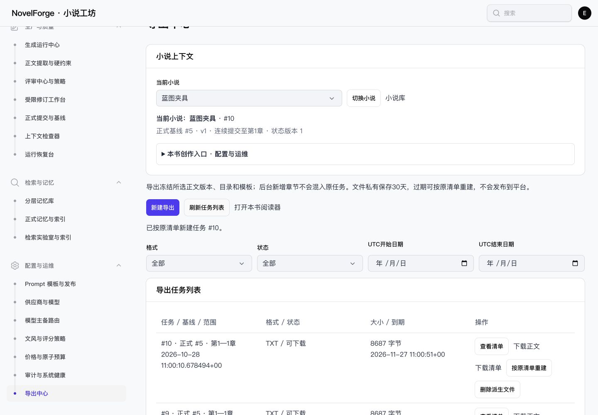

# NF-E08 验收记录

日期：2026-10-28。状态：implemented_core_verified。

## 交付

[实施契约与接口](CONTRACT.md)。新增ReadingService、ExportService、持久Job、HTTP接口、连续阅读/版本比较与导出中心。采用现有Filament公共组件、书级上下文、原生弹窗及中文字段；默认任务列表，新建按钮80×40px，未替换前端框架。

默认正式来源经canonical_chapters与committed提交校验；没有映射即显示缺章或拒绝导出。显式草稿独立标记。冻结精确版本、卷章标题、body_hash、模板与排版，按原清单重建。TXT/Markdown保留源正文UTF-8字节，私有附件每次鉴权并核对哈希；文件30天到期，删除仅移除派生字节并留下清单/墓碑和审计。

人工已读和问题只追加，问题按Unicode码点及精确引文绑定版本。差异为保守行区间，优先显示变化，完整公共前后文可展开；不改变正式正文、评审或成品认可。

## 自动验证

[关联回归](PHPUNIT.log)/[JUnit](PHPUNIT.xml)：73项全部通过、1333断言，1364920ms。包含ReadingExportTest原13例、CanonicalCommitTest、CanonicalMemoryTest、DraftingTest、DraftingRecheckTest、NovelNavigationTest、UiFoundationTest、ProductionUiTest。

另增[整卷/全书/单章补验](SUPPLEMENT.json)/[JUnit](SUPPLEMENT.xml)：1项通过、8断言，34463ms；缺章列表覆盖整个声明选区，不能将已提交前缀冒充整卷/全书。两轮测试名称无重叠，合计74项独立用例、1341断言；[汇总](TEST_SUMMARY.json)。先前4项54断言定向复测不重复计入。

复现（仅既有专用测试环境，禁止指向开发库）：

```sh
php -d memory_limit=512M vendor/bin/phpunit --filter='ReadingExportTest|CanonicalCommitTest|CanonicalMemoryTest|DraftingTest|DraftingRecheckTest|NovelNavigationTest|UiFoundationTest|ProductionUiTest'
vendor/bin/pint --test
```

现在源码中的ReadingExportTest包含14例，上述命令一次运行将包含补验用例；已归档的两轮记录保持原始数量。

真实PostgreSQL及隔离文件存储：正式/草稿分离、缺章/跨书基线拒绝、冻结后新增章/书名修改不混入、两种格式、同键重试/异载荷冲突、过期/删除/精确重建、文件损坏、真实数据库队列重复消息、固定码写入失败、过期租约旧令牌拒绝、Unicode与HTML安全、阅读记录、数据库不可变触发器和中文备注，以及后台懒加载/取消/预检与缺章状态。

[构建](BUILD.log)通过，855ms，已有可选fontaine提示保留；[Pint](PINT.log)及git diff --check结果见收口文件。构建在最终回归前完成，没有在同一测试进程中重建manifest。本轮不是全业务套件验收。

## 浏览器

[原始记录](BROWSER.json)、[16项断言](BROWSER_CHECKS.json)、[阶段数据库验证](BROWSER_DATABASE.json)。只访问127.0.0.1:8779、APP_ENV=testing、novel_forge_test；正常登录0600临时凭据。通过既有完整离线链建立夹具：2本书、1个正式章、1条fake模型请求，后续阅读与导出未增加请求。

- 正式正文、目录、已读与1条实际精确引文问题；错误引文被拒绝且焦点在引文字段，修正后回正文。
- 默认列表不渲染新增表单；缺章预检/提交拒绝、失败保值，修正范围后冻结任务并回新建入口。
- 真实database队列消费者生成文件；候选编辑后按原清单重建，两个任务均ready，manifest_hash与文件checksum相同，正式版本仍为原版本。不是直接写库伪造导出成功。
- 1440/390无根页面横向溢出、无重复ID，390编辑/清单/差异窗口358px；Escape和关闭返回入口。
- 原生删除确认的即时isVisible采样为false，后续焦点在取消按钮、实际取消成功，阶段文件仍在；不以过渡采样声明稳定可见性通过。
- 差异使用实际同章候选，新增𠮷字与😀可见；正式正文和已冻结导出没有改变。

早期预检误用公共状态组件不支持的warning值，服务已执行但渲染失败；改为notice并补非空缺项渲染回归，preflight_fixed_390为最终证据。早期默认截图有390×202缩放异常，仅保留为中间记录；交付使用明确clip补拍的390×844 verified截图，已目视核对。没有把早期失败或缩小截图当通过证据。



- [正式阅读器](screenshots/reader-1440.jpg)、[引文错误](screenshots/reading-quote-error-1440.jpg)
- [窄屏阅读器](screenshots/reader-mobile-390-verified.jpg)、[窄屏导出列表](screenshots/exports-mobile-390-verified.jpg)、[窄屏差异](screenshots/version-diff-mobile-390-verified.jpg)
- [导出弹窗](screenshots/export-editor-1440.jpg)、[缺章拒绝](screenshots/export-missing-1440.jpg)、[修复后的预检](screenshots/export-preview-mobile-390.jpg)

## 数据库与清理

[MIGRATION.json](MIGRATION.json)：已对指定开发库novel_forge执行私有custom备份，并用pg_restore --list验证后，仅应用本次迁移。新增4表55字段全部具有中文备注，原用户/小说/正式提交/正文/请求计数不变，新表无夹具数据。备份在.local/backups，不提交、不包含在本报告中；报告仅保留路径及校验信息。

隔离预览、补拍标签和viewport已关闭/恢复，临时凭据已删除，两份本轮私有派生文件已按严格路径规则清理。最终测试库清空情况及文件边界见SCOPE.json。开发库没有写入测试小说或模型请求。

## 首轮与覆盖限制

[早期验证记录](EARLY_RESULTS.json)保留初版视图契约、重复函数和缺失导入问题及原始产物SHA。失败原始日志不归档通用报告，避免复制完整SQL/栈；最终结果单独记录，不以定向通过替代完整关联回归。

未进行真实模型、文学成品、连续十章/百章、Safari/读屏、200%字体或1000章性能P95验收；这些仍归原F/H阶段。30天是本轮文件默认策略，统一可配置生命周期归H02/H04。硬崩溃遗留但未登记的令牌文件仍需运维清理策略，不能据本轮测试宣称进程硬杀恢复和全量存储回收已验收。数据库队列与令牌过期场景已验证，不宣称重新验收Redis生产托管。

导出需要监听export队列的Worker和现有调度器；命令见CONTRACT.md。没有因本项完成而关闭NF-A02服务托管任务。

只更新NF-E08状态；UI13/UI14终局依赖纠正为NF-G04，不改变其状态。NF-UI08历史缺口及其他业务任务均保持，未自动推进NF-F01。
