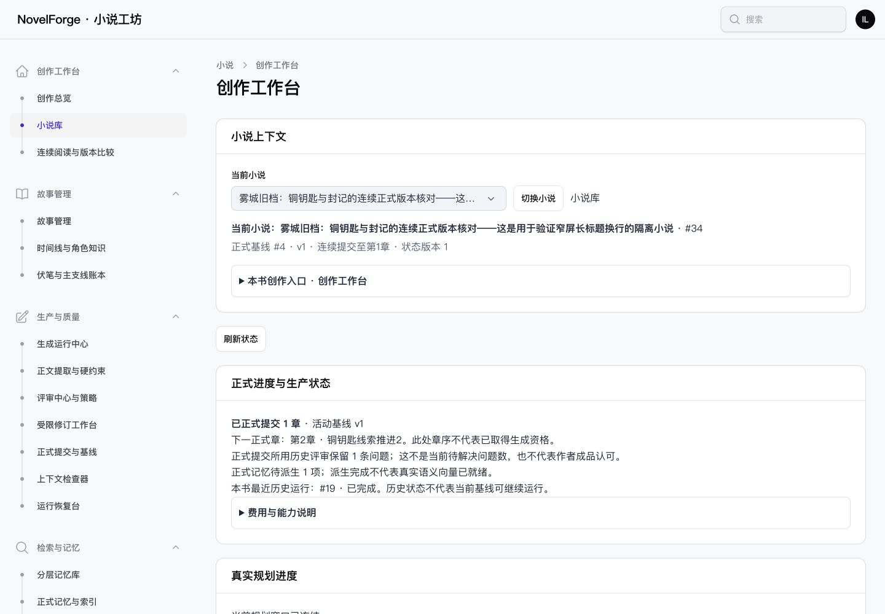

# NF-UI14 验收记录

日期：2026-10-28。状态：implemented_core_verified。

## 实施

工作台已接入活动正式基线的连续提交章数、下一实际章骨架、当前页正式版本与提交时评审、正式记忆待派生数、本书最近历史运行、UTC分币种费用及明确引用政策的全书风险余量。[读取契约](CONTRACT.md)记录字段、来源和边界。

没有唯一全书默认预算政策，因此不编造“当前可花余额”：界面引用最近预算请求的政策，显示停止线、全书累计风险与参考余量；未核销实际金额保持未知，风险预留单列，多币种不相加。历史运行和历史费用明确标注，不伪装为活动基线继续资格。正式评审列只读取提交所用版本，不宣称是当前候选评审。

阅读、导出、运行、评审、正式提交、正式记忆与恢复链接到已有同书页面。真实生成继续禁用；归档可查看历史，目标服务写门禁未改。Worker在线状态、终局准备度继续未知；总览本轮不接入。无迁移、无真实模型、无中文分词、无生产启动引擎改动。

## 自动验证

[汇总](TEST_SUMMARY.json)：41个独立用例按最后执行结果全部通过，627断言。

- [关联回归](REGRESSION_TESTS.xml)：40项通过、616断言，包含工作台、生产投影、导航、故事UI、公共UI。
- [最终定向](FINAL_TARGET_TESTS.xml)：16项通过、170断言；覆盖所属作者共享锁补强及新增的临时基线读取测试。两轮重叠不重复计数。
- [最初定向](TARGET_TESTS.xml)：14项通过、153断言；保留原结果，不另计入汇总。
- [环境首轮](TEST_ROUNDS.json)：沙箱拒绝数据库连接，14项在隔离引导阶段报错、0断言；未绕过数据库守卫，获执行权限后重跑。原始失败没有当成功。

核心覆盖：未初始化与合法空根0章区分、提交1章与下一章、候选新版本不覆盖正式版本、筛选不改变全书正式前缀、跨书/非管理员拒绝、归档历史可读、未知费用/核销零值、多币种/精确金额、UTC跨日、读取异常不渲染空态、同书入口和真实生成禁用。

旧基线隔离使用PostgreSQL事务临时表模拟新活动根，保留旧正式映射，确认新前缀为0且旧评审/待派生任务不混入；再模拟不完整游标，结果unavailable而非旧分支或零。**这不是G01真实重基线切换验收。** 测试只在novel_forge_test，HTTP游离请求禁止。

复现（已有隔离环境）：

```sh
php -d memory_limit=512M vendor/bin/phpunit --filter='WorkspaceProductionTest|WorkspaceTest|NovelNavigationTest|StoryUiTest|UiFoundationTest'
vendor/bin/pint --test
npm run build
```

构建须与PHP回归串行。[Vite构建](BUILD.log)通过，已有可选fontaine提示保留；[全仓Pint](PINT.log)通过。本轮不是全业务套件验收，也不关闭历史全量单进程内存问题。

## 浏览器

仅使用127.0.0.1:8784，APP_ENV=testing、novel_forge_test、项目专用Redis socket和测试存储。通过现有完整离线候选→评审→正式提交服务建立夹具；临时管理员正常登录。[阶段计数](BROWSER_COUNTS.json)、[DOM与跳转证据](BROWSER.json)。

- 1440桌面显示正式1章、实际第二章、正式v1/提交时评审及待派生1项；费用展示完整十进制与参考政策。
- 390px根页面无横向溢出；长书名自然换行，操作组换行、表格局部滚动。深色正式进度区目视检查通过。
- 阅读与导出链接实际点击后进入同一本书；阅读器显示真实正式第1章，导出中心显示真实空列表，没有点击就创建导出任务。
- 费用details可点击展开、Enter收起。反向章范围显示筛选错误；重置后恢复正式进度。
- 通过小说选择器切到空书，上一书正式章数、运行及入口参数不残留。第一次AX索引点击选中占位项，未当作切书成功；改用精确menuitemradio选择并确认后成功。
- 首次等待登录导航发生浏览器CDP超时，后续实际页面确认正常登录，不归因于业务错误。首张mobile截图因滚动/视口切换捕获效果异常仅保留为中间记录；最终操作区与深色截图重新捕获并目视检查。



[窄屏操作入口](screenshots/workspace-mobile-final.png) · [深色正式进度](screenshots/workspace-dark-mobile.png) · [筛选错误](screenshots/filter-error.png) · [切书空态](screenshots/empty-book.png)

## 范围与限制

没有浏览器复测全部目标页面写操作、Safari、200%纯字体、完整读屏或千章性能。数据库读取异常由自动回归注入验证；浏览器验证了筛选错误恢复，不冒充真实数据库断连演练。当前投影查询在数据库聚合，版本载入最多当前页100章；既有规划摘要扫描未改，本轮不宣称全工作台已达千章性能指标。

同步纠正UI规划中本项终局依赖的旧笔误（E08改为G04），与开发任务清单一致。只有NF-UI14更新状态；UI11–13、UI08历史缺口、F01、G01、G04和其他任务不变。源代码及记录保留工作区，未执行Git提交。


## 清理

浏览器主题恢复为系统模式，临时视口已重置，标签页关闭，8784预览进程及本轮专用Redis已停止，临时明文登录文件与预览脚本删除。浏览器阶段3本隔离书、1次fake请求、1个正式提交、0导出任务；清理时复验工作台权限1项/5断言通过，不重复计数。[清理后计数](CLEANUP.json)为users/novels/canonical_commits/ai_requests/export_jobs全部0，数据库名确认novel_forge_test。没有连接开发库执行本轮测试或迁移。
