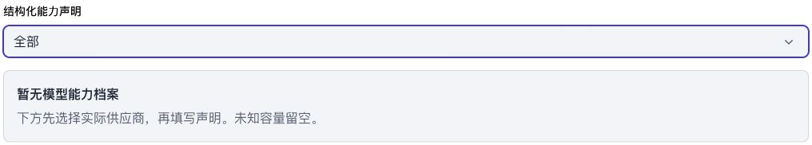
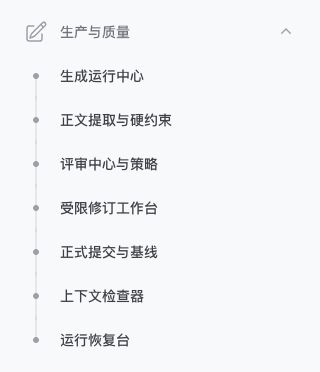

# NF-UI22 导航图标与筛选留白验收

日期：2026-10-27；主规范沿用Interface Design / DESIGN.md。本轮开始已有NF-UI20/21未提交改动，完整保留，仅新增本项。

## 修复

截图位置1：五个一级分组使用原生NavigationGroup图标；所有21个二级菜单使用Filament的圆点、连接线和活动色。移除StoryHub、ExtractionLedger、ReviewCenter、RevisionDesk的显式导航图标；Overview覆盖Dashboard默认图标返回空。实际安装的Filament会拒绝“分组和子项同时有图标”，因此不能只给分组增加图标或只隐藏SVG。

截图位置3：原模型能力筛选字段与后继空态间距实测0px；公共Section内独立筛选/网格与紧邻状态块增加16px。没有修改截图位置2保存按钮宽度或业务动作。

导航分组标签、顺序、21项目标URL逐项与改动前一致；不改路由、权限、服务、数据库、模型调用或表单载荷。新增代码中文注释；没有新增数据库表或字段。

## 验证

| 验证 | 实测 |
| --- | --- |
| 桌面1440×1000 | 5组各1图标、21子项圆点、0子项图标；间距16px，无页面横向溢出 |
| 窄屏390×844及抽屉展开 | 同样的图标/圆点结构；间距16px，无页面横向溢出 |
| 分组折叠及还原 | aria-expanded false→true |
| 移动端点击正文提取 | 原URL /admin/extraction-ledger，抽屉自动关闭 |
| 首页活动标记 | 唯一aria-current仍为创作总览，使用圆点 |
| PHPUnit | 16/16，342断言，37337ms；包括新增真实菜单元数据、首页/供应商活动态DOM用例 |
| Vite | 构建通过，601ms；构建完成后才启动测试，未并发重建 |
| Pint与文件范围 | 见最终PINT.log及SCOPE.json |

证据：[浏览器测量](browser.json)、[断言结果](CHECKS.json)、[PHPUnit日志](PHPUNIT.log)、[JUnit](PHPUNIT.xml)、[构建](BUILD.log)、[Pint](PINT.log)、[文件边界](SCOPE.json)、[清理](browser-cleanup.json)。控制台记录见[console.json](console.json)。

## 截图

- [改动前](screenshots/before-1440.jpg)、[改动后桌面](screenshots/after-1440.jpg)、[窄屏间距](screenshots/after-390.jpg)
- [完整五组导航，1440×1400](screenshots/sidebar-complete-1440x1400.jpg)、[窄屏抽屉](screenshots/sidebar-390.jpg)

## 范围与收尾

Chrome真实浏览器、正常登录的临时测试管理员，预览只绑定127.0.0.1:8776；既有测试守卫限定novel_forge_test，HTTP阻止游离请求。没有真实模型请求或中文分词安装。临时凭据不入证据，本轮服务器、凭据、标签及viewport已清理/恢复；最终测试库计数另见SCOPE.json。

只对本次两个展示问题做验收；未重做全页面各数据分支、Safari、200%缩放、纯字体或读屏验证，不宣称全部WCAG通过。历史验收与其他已完成任务状态保持；无新增阻断事项。
