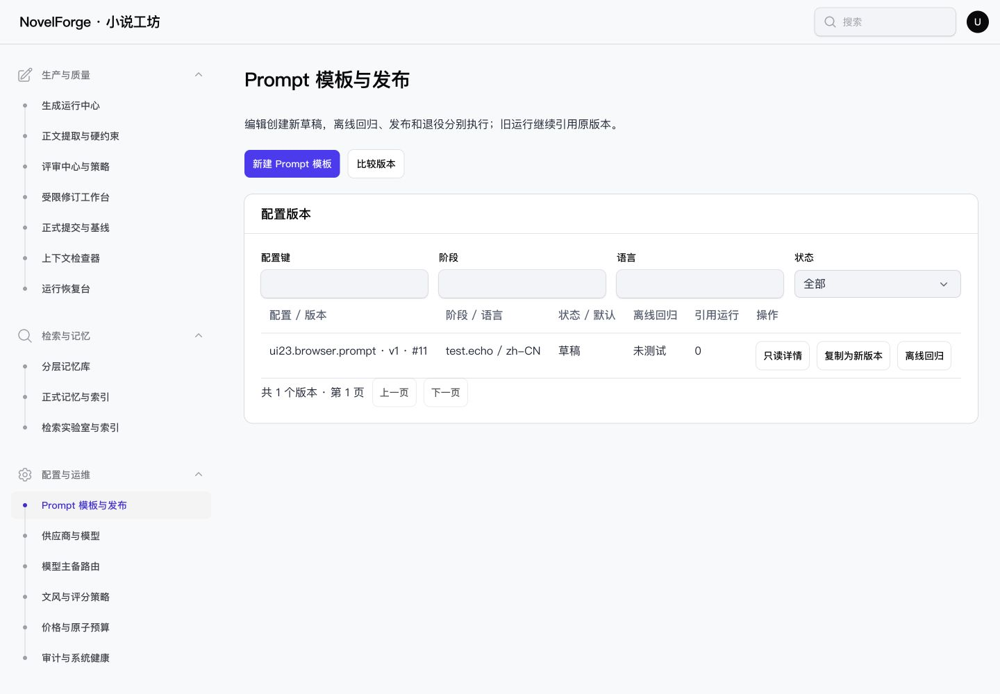
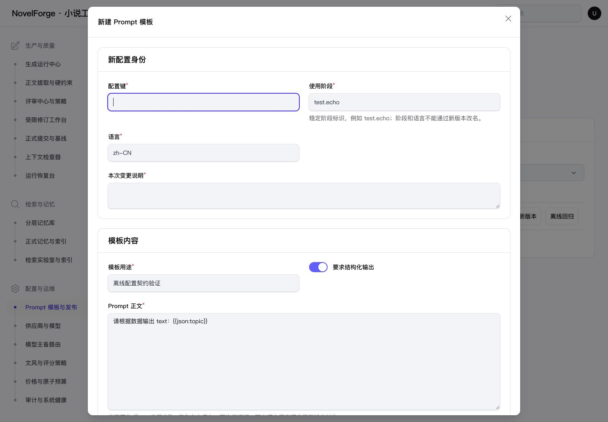

# NF-UI23 配置列表与新增弹窗验收

完成日期：2026-10-28。沿用Interface Design及项目原生Filament；保留本轮开始前NF-UI20～22未提交成果，只新增本项。

## 结果与范围

四个配置菜单：Prompt模板与发布、模型主备路由、文风与评分策略、供应商与模型。默认只展示列表、筛选和工具栏；新增内容不再常驻页面。新建、复制新版本、只读详情及比较通过原生弹窗展示。

Prompt新建按钮实测137.71×40px，供应商按钮94×40px；手机同样随内容显示。共享editor-modal复用Filament焦点陷阱、Escape/关闭、焦点返回和滚动锁，禁止点击遮罩直接丢弃内容；桌面最大1024px、390手机窗口358px。长表单在窗口内滚动。

配置树、字段、未知值、只读历史、乐观锁、幂等键和服务校验保留。成功关闭回列表；失败保留编辑器及安全输入，首次/重复失败聚焦弹窗内错误。供应商和模型仍是原生POST，失败重定向根据原ui_form恢复对应弹窗；密钥清空且不进入Livewire。

修改仅限展示视图、共享弹窗、UI展示状态/事件、样式及测试。业务服务、控制器、路由、模型、数据库和任务编排未改；没有真实模型请求和中文分词工作。

## 浏览器验证

[浏览器原始记录](BROWSER.json)、[断言结果](CHECKS.json)。

| 场景 | 结果 |
| --- | --- |
| 四页默认列表 | 新增表单不渲染，无打开的编辑弹窗，按钮非通栏 |
| Prompt新增 | 无效属性名被原规则拒绝，输入保留；修正后保存v1，关闭回列表并返回新建入口 |
| 复制/详情/比较 | 复制保留原身份与只读键，取消不产生版本；只读详情和比较独立弹窗 |
| 供应商/模型原生POST | 跨字段错误后分别自动重开provider-new/model-new，安全字段保留；修正后均回列表 |
| 密钥 | 输入探针未出现在wire:snapshot，失败重定向后密码为空；测试阶段无模型请求 |
| 390手机 | Prompt/路由/文风/供应商弹窗358px，窗口与根页面无横向溢出；Shift+Tab仍在弹窗内，取消返回入口 |
| 深色 | Prompt新增弹窗抽检，完成后恢复系统主题 |
| 最终控制台 | 新标签复测未捕获error；见console-final.json |

部分早期测量来自1709px原窗口尺寸，按BROWSER中实际width保留，不冒充1440验收；最终桌面依据final_editor_1440及相应POST/焦点复测记录，手机依据390记录。

## 首轮发现及修复

1. 原生组件属性中的@js指令未展开，浏览器报初始化语法错误；改为Blade布尔插值。[首轮控制台](first-console.json)保留，最终无同类错误。PHP测试不能替代浏览器验证。
2. 树字段校验失败时焦点曾落到背景；仅派发既有事件不足以覆盖该场景，补充当前弹窗内的错误摘要初始化与重复提交定位。保留validation_focus_final_1440等中间失败数据并标明phase，最终以validation_focus_fixed/validation_repeat_fixed为准。
3. 浏览器权限审核曾超时，按工具允许重试一次后恢复；没有绕过权限控制。原生弹窗过渡期间的即时状态只作中间观察，不能替代关闭后的焦点记录。

## 测试和构建

首轮[34例/555断言](FIRST_PHPUNIT.log)通过；加入错误焦点事件断言后，[最终34例/556断言](PHPUNIT.log)通过，58995ms；[JUnit](PHPUNIT.xml)。包含原ConfigurationUiTest版本/导入/锁定身份/POST安全/历史测试、新增4例弹窗状态用例，以及导航和公共UI回归。

[最终构建](BUILD.log)通过，698ms；构建清单SHA与浏览器取证时一致。构建完成后才启动最终测试，没有并发重建。[全仓Pint](PINT.log)、[文件边界](SCOPE.json)及git diff --check见收口结果；不是全业务测试套件。

## 截图

- [供应商/模型列表](screenshots/providers-populated-list-1440.jpg)、[POST错误重开](screenshots/provider-post-error-1440.jpg)
- [Prompt手机](screenshots/prompt-editor-390.jpg)、[供应商手机](screenshots/provider-editor-390.jpg)、[路由手机](screenshots/route-editor-390.jpg)、[文风手机](screenshots/style-editor-390.jpg)
- [错误焦点修复](screenshots/prompt-error-1440.jpg)、[深色](screenshots/prompt-editor-dark-1440.jpg)

## 隔离与覆盖边界

只访问APP_ENV=testing的127.0.0.1:8777，正常登录临时管理员，既有守卫限定novel_forge_test，HTTP阻止游离请求。[浏览器阶段计数](database-stage.json)：一个合成Prompt版本、一个供应商、一个模型档案，0小说、0模型请求；最终回归已将这些合成夹具全部清空，计数见SCOPE.json。凭据文件0600且未纳入报告；本轮预览进程、凭据、标签及viewport已清理/恢复，[清理记录](browser-cleanup.json)。最终测试库计数见SCOPE.json。

仅本轮四页相关流程及状态验证，不宣称全站所有数据分支、Safari、200%页面/纯字体放大或读屏验收。既有业务任务及历史完成状态保持；无新增阻断事项。
