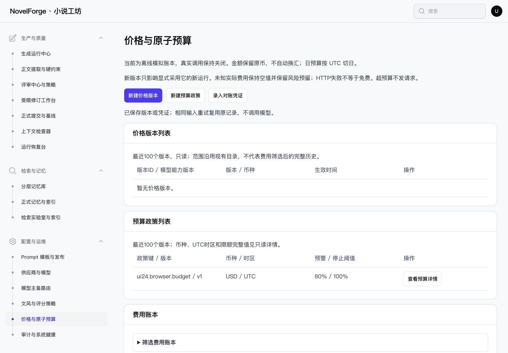

# NF-UI24 验收记录

日期：2026-10-28。状态：implemented_core_verified。

## 交付范围

[配置页面矩阵](PAGES.md)覆盖六个配置菜单。本轮仅修改Billing、AuditCenter页面类及对应Blade视图，增加独立回归用例和文档。复用现有Interface Design、原生editor-modal、动作工具栏及生产字段树；未改共享组件/CSS、业务服务、接口、模型或数据库。

价格页默认提供价格版本列表、预算政策列表、费用账本。三种输入通过正常大小按钮打开对应编辑弹窗；最近100条目录上限、费用筛选/分页/导出、原币精确字符串与未知费用保持。成功关闭回表，失败留在弹窗内，取消不写入，关闭重开相同输入仍使用原幂等键。账本、版本完整证据保留于只读弹窗。

审计页默认是审计表格与真实数据库健康摘要，原筛选、导出和分页保留；完整健康信息、追踪号及前后记录在只读弹窗内。没有新增审计操作或外部健康探测。

## 浏览器验收

仅访问APP_ENV=testing、novel_forge_test的127.0.0.1:8778；正常登录临时单管理员，现有测试库守卫与禁止游离HTTP请求保持。[原始数据](BROWSER.json)、[12项断言](CHECKS.json)、[阶段计数](STAGE_COUNTS.json)。

| 场景 | 实际结果 |
| --- | --- |
| 1440默认价格页 | 新增字段0、打开弹窗0；三个按钮均108×40px |
| 价格/预算/对账新增 | 各自按需渲染一个既有字段树；无其他编辑器混入 |
| 空预算提交失败 | 弹窗保留，焦点位于首个错误字段，字段树与重试键由PHP回归验证 |
| 有效预算保存 | 逐字段填写，成功回列表，焦点回新建预算入口 |
| 原输入重开重试 | 列表仍只有v1；阶段库中1个预算政策、1个billing_command、1条审计 |
| 完整预算证据 | 123.4500000001按原精度保留，未转为浏览器浮点数 |
| 对账未知用量 | 明确显示空值未知，不是零或空文本；空实际请求目录无伪造选项 |
| 审计列表/详情 | 展示本轮合成预算审计，完整记录只读；Escape关闭回详情入口 |
| 健康弹窗 | 显示数据库观测完整投影；Tab焦点仍在窗口，Escape关闭 |
| 390手机 | 价格页、审计页无根页面横向溢出；对账/审计/健康窗口358px，内容宽度不溢出 |

取消价格和对账均回到原入口；只读预算详情关闭后返回查看预算详情按钮。长表单在原生窗口中滚动，沿用既有键盘顺序与焦点陷阱。

## 测试、构建与首轮问题

[最终回归日志](PHPUNIT.log)、[JUnit](PHPUNIT.xml)：79例全部通过，1078断言，214937ms。覆盖新增5例（默认列表/懒加载/取消无写入、失败保值和重试键、精确金额及同输入幂等、只读目录详情、外部操作人审计隔离），并回归BillingSelectTest、BillingTest、RunCenterTest、ProductionUiTest、UiFoundationTest、NovelNavigationTest、ConfigurationModalUiTest与ConfigurationUiTest。不是全业务套件。

复现命令（项目根目录，沿用既有测试环境守卫）：

```sh
php -d memory_limit=512M vendor/bin/phpunit --filter='RemainingConfigurationModalUiTest|BillingSelectTest|BillingTest|RunCenterTest|ProductionUiTest|UiFoundationTest|NovelNavigationTest|ConfigurationModalUiTest|ConfigurationUiTest'
npm run build
vendor/bin/pint --test
```

构建与PHP测试顺序执行，不在同一回归期间重新构建Vite资源。

首轮61例中60通过，新增审计夹具错误地创建第二管理员，触发既有users_single_admin约束。修正为普通外部操作人，保留单管理员约束；[脱敏首轮摘要及原始产物SHA256](FIRST_REGRESSION.json)。失败SQL带随机夹具认证字段，因此不归档原始失败SQL日志。

[构建](BUILD.log)成功，879ms；已有可选fontaine优化警告保留，不作为失败或本轮依赖安装任务。构建结束后运行最终测试，未在回归进程中重建manifest。[全仓Pint](PINT.log)通过。

## 截图与证据



- [预算编辑](screenshots/budget-editor-1440.jpg)、[完整十进制详情](screenshots/budget-detail-1440.jpg)
- [390对账弹窗](screenshots/reconcile-mobile-390.jpg)、[390列表](screenshots/billing-list-mobile-390.jpg)
- [审计列表](screenshots/audit-list-1440.jpg)、[390审计详情](screenshots/audit-detail-mobile-390.jpg)、[390数据库观测](screenshots/health-mobile-390.jpg)

## 隔离、收口与限制

浏览器阶段0小说、0模型请求、0价格版本，仅1个合成预算政策用于验收。临时凭据0600，不入文档；验收后删除该文件、停止本轮8778进程、关闭本轮标签并恢复viewport。最终回归清空夹具的计数与文件边界见SCOPE.json。

本轮为两页相关流程验收与原配置契约回归；既有另外四页仅源码及自动回归复核，不冒充重新浏览器全验收。未复测Safari、深色、200%页面/纯字体缩放、完整读屏或全部账单分支。浏览器价格/对账仅验证打开、空实际记录、未知值和取消；有效价格/对账、原子预算拒绝及账本业务状态由既有PHP回归覆盖。没有真实模型调用、中文分词或外部费用交易。

只追加NF-UI24记录，其他任务状态和历史证据保持。无新增阻断；现有浏览器与业务范围限制按上述记录保留。
